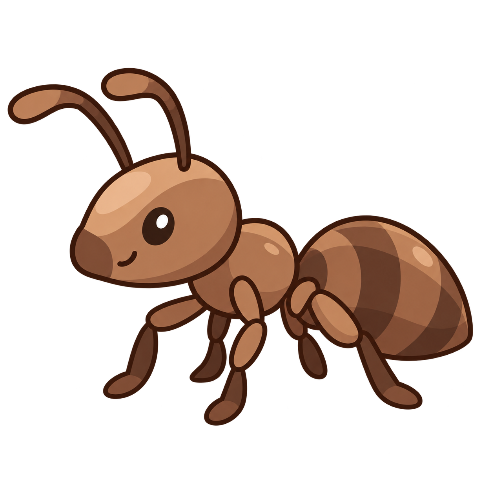
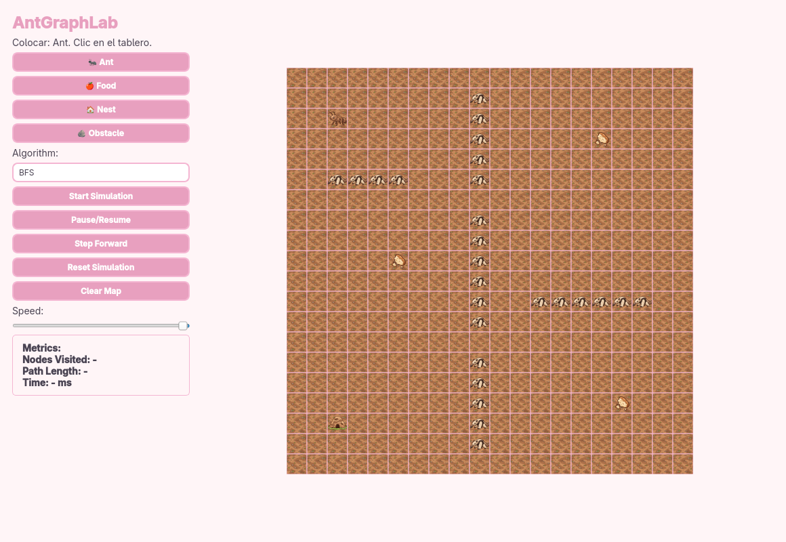
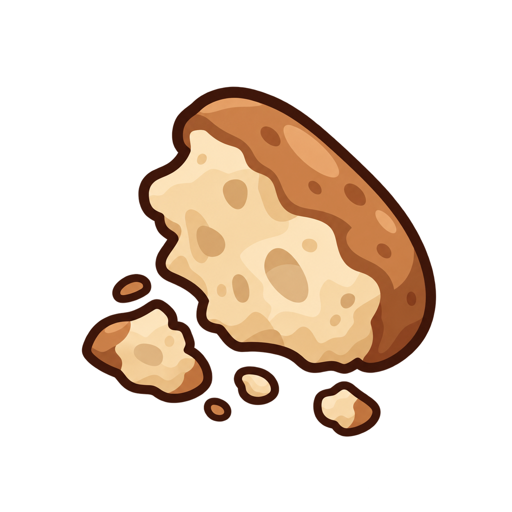
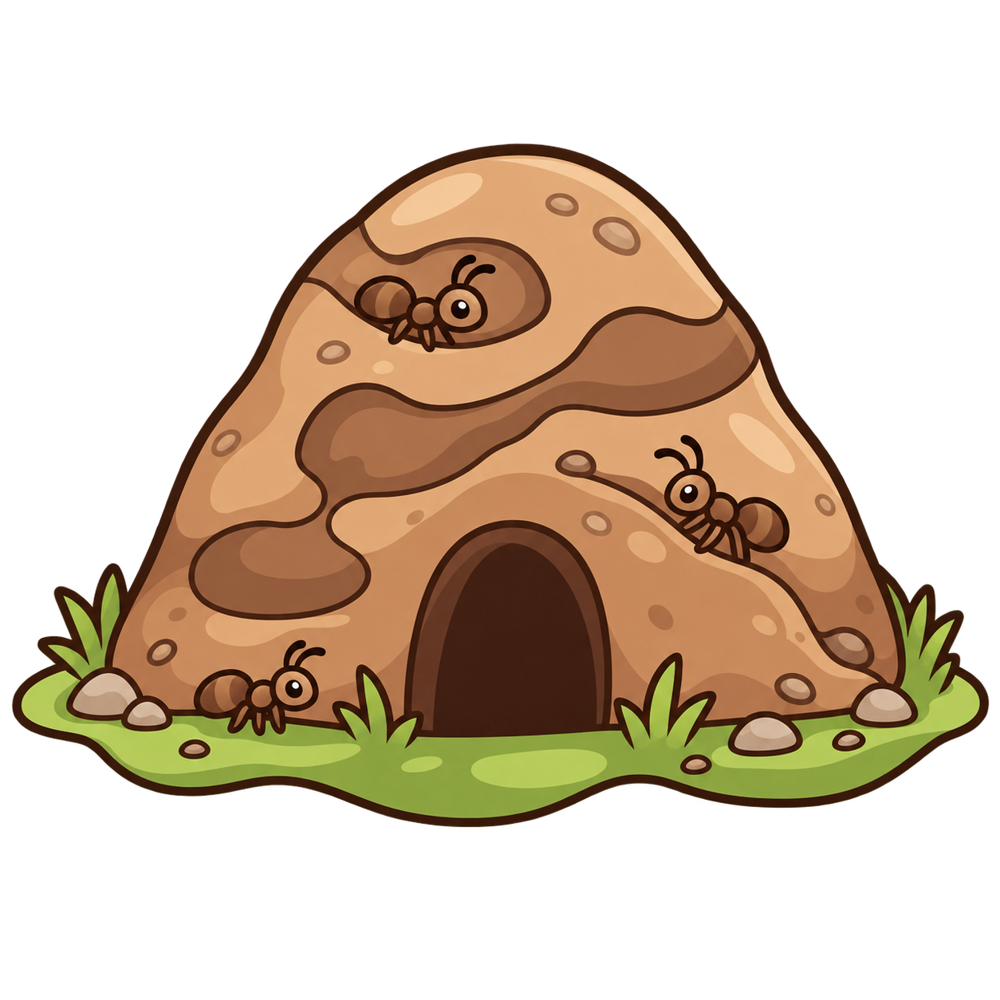
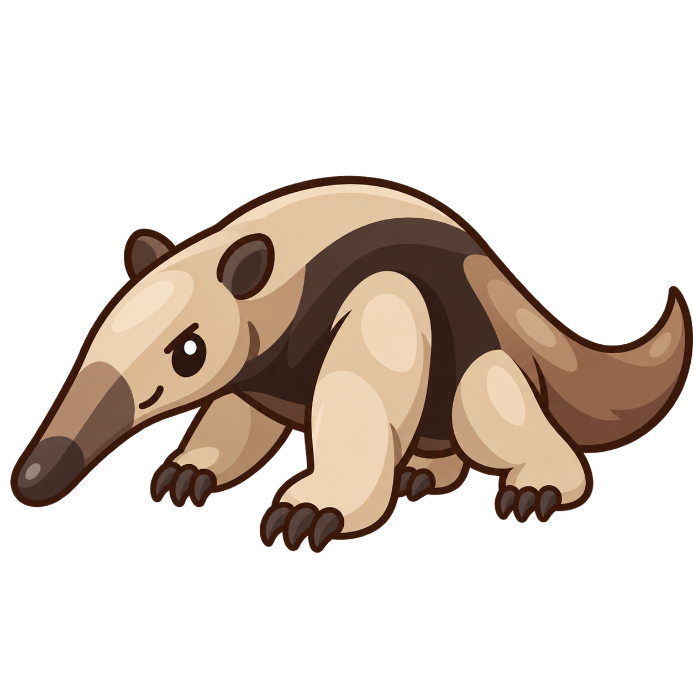
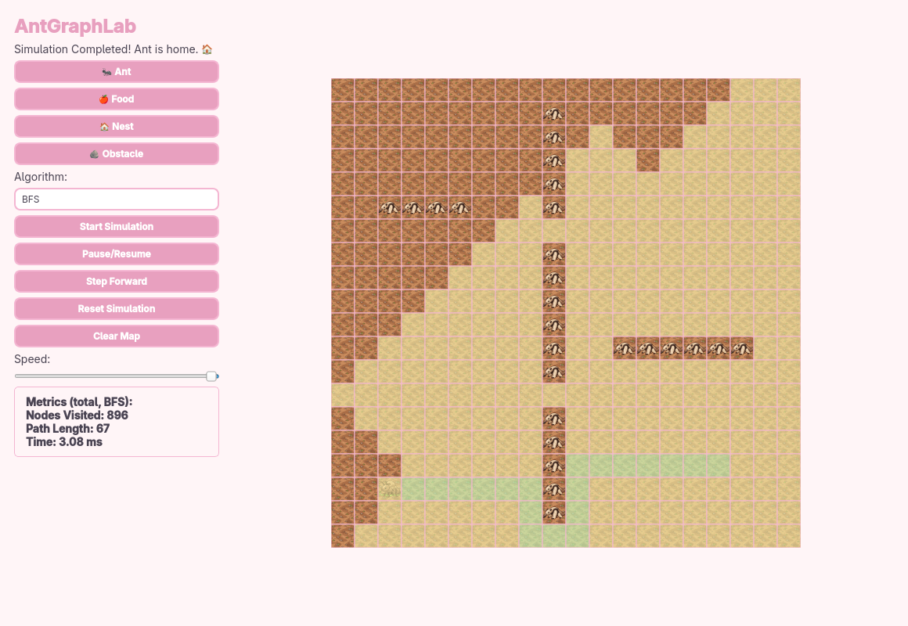

<div align="center">



<h1>AntGraphLab</h1>

<p>Construye un mapa. Encuentra la comida. Vuelve a casa.</p>

<p><sub>Python · PyQt6 · BFS · DFS</sub></p>

</div>

<br>



Un laboratorio visual de grafos donde una hormiga recoge las comidas distribuidas
en el mapa y regresa al hormiguero. Construye el escenario y observa cómo cambia
el recorrido al elegir búsqueda en anchura o en profundidad.

<p align="center">
  
  &nbsp;&nbsp;&nbsp;&nbsp;
  
  &nbsp;&nbsp;&nbsp;&nbsp;
  
</p>

## Explora

1. Selecciona un elemento y colócalo con un clic o arrástralo al tablero.
2. Distribuye varias comidas, una hormiga, un hormiguero y los obstáculos.
3. Elige **BFS** o **DFS** e inicia la simulación.

Puedes pausar, avanzar un paso y ajustar la velocidad. El clic derecho borra una
celda; **Reset Simulation** restaura el escenario y **Clear Map** vacía el tablero.

## Del mapa al recorrido



Los colores muestran la exploración y la ruta. Al terminar, el panel reúne los
nodos visitados, la longitud del recorrido y el tiempo de búsqueda.

## Ejecución

Desde la raíz del proyecto, en tu entorno virtual con PyQt6 instalado:

```bash
python main.py
```

---

<p align="center">
  <sub>Diego Eduardo Zapata Aguilar · Melissa Jazmin Torres Martinez · Georgina Reta Limas</sub>
</p>
