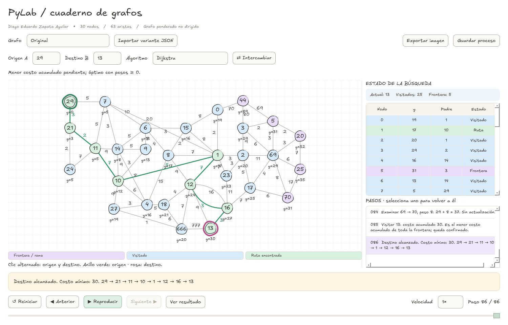
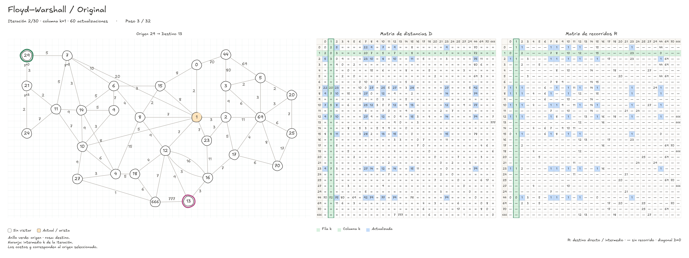

<div align="center">

# Graph Search Algorithms · PyLab

Explora un grafo. Sigue cada decisión. Compara las rutas.

[](#ejecutar)
[](#algoritmos)
[](#pruebas)

**Python · igraph · PyQt6**

</div>

Laboratorio visual para aprender búsquedas en grafos ponderados. Selecciona origen y destino, reproduce la exploración y retrocede para ver cómo cambian las distancias y decisiones. Los ocho algoritmos están implementados manualmente en Python; igraph representa el grafo y PyQt6 dibuja la interfaz.

<p align="center">
  
</p>

<div align="center">

**30 nodos · 63 aristas · 8 algoritmos**<br>
Diego Eduardo Zapata Aguilar

</div>

## Ejecutar

Requiere **Python 3.10 o superior** y un entorno de escritorio.

```bash
git clone git@github.com:ZapataFrame/graph-search-algorithms-pylab.git
cd graph-search-algorithms-pylab
python3 -m venv .venv
source .venv/bin/activate
python -m pip install -r requirements.txt
python main.py
```

En Windows, activa el entorno con `.venv\Scripts\activate`. La instalación inicial requiere Internet; la aplicación funciona localmente.

Elige **Origen A**, **Destino B** y un algoritmo. Usa **Reproducir / Pausar**, **Anterior / Siguiente**, la velocidad o el historial para recorrer los pasos. En los algoritmos con grafo puedes seleccionar los nodos con clics alternados. Floyd–Warshall presenta las dos matrices.

**Exportar imagen** guarda el paso actual como PNG centrado y coloreado. **Guardar proceso** crea una carpeta con imágenes numeradas y `proceso.json`; puedes cancelar conservando lo exportado. Los PNG se dibujan directamente en **3200 × 1800 píxeles**, con panel explicativo compacto y una leyenda que muestra solo los colores usados en el paso. El grafo lleva una cuadrícula al **15 %** de opacidad, pesos sin recuadros y aros de origen/destino reforzados.

El tema usa fondo blanco, colores pastel, trazos de boceto y **Excalifont**, incluida con su [licencia SIL OFL](assets/fonts/LICENSE.txt).

## Algoritmos

| Algoritmo | Cómo explora | Qué garantiza |
| :--- | :--- | :--- |
| **Dijkstra** | El menor costo acumulado de toda la frontera | Menor peso, con pesos no negativos |
| **A*** | Prioriza `f = g + h`, con heurística consistente | Menor peso, con pesos no negativos |
| **Bellman–Ford** | Relaja arcos y detecta ciclos negativos | Menor peso si ningún ciclo negativo afecta al destino |
| **BFS** | Por niveles, con una cola | Menor número de aristas |
| **DFS** | En profundidad, con una pila | Una ruta, sin garantía de mínimo |
| **Fuerza bruta** | Todos los caminos sin repetir nodos | Menor peso entre caminos simples al completar la enumeración |
| **Voraz local** | La arista más barata del nodo actual | Puede costar más o quedarse bloqueado |

Dijkstra también es voraz: su elección usa el **costo acumulado**, mientras que el voraz local usa el **peso de una sola arista**. En este grafo, de **666 a 13**, Dijkstra obtiene costo **13** y el voraz local obtiene **19**.

> [!IMPORTANT]
> La fuerza bruta tiene un límite ajustable de **10000 pasos** por defecto. Si lo alcanza, la ruta es **provisional** y no garantiza el mínimo. Se puede pausar y avanzar paso a paso, o usar **Calcular resultado** para procesar por lotes.

El selector incluye **Original**, **Valores negativos** (no dirigido, `graphs/negative.json`) y **Dirigido · pesos negativos** (`graphs/directed-negative.json`). Los dos archivos se cargan automáticamente. La variante transcribe la [segunda imagen](assets/grafo-negativo.png), corrige la etiqueta 66 a **666** y conserva las aristas no dirigidas y las dos aristas paralelas 12–16. Consulta el [formato del grafo](graphs/README.md). Dijkstra y A* no están disponibles con pesos negativos. En un grafo no dirigido, una arista negativa permite un ciclo negativo de ida y vuelta; Bellman–Ford lo detecta y marca los nodos afectados con costo `−∞`.

La nueva [imagen dirigida](assets/grafo-dirigido-negativo.png) conserva los 30 nodos, 63 arcos y ocho pesos negativos. Las flechas se respetan: por ejemplo, `21 → 29`, `15 → 6`, `17 → 2` y `666 → 13 = −777`. En esta variante no hay ciclos negativos y Bellman–Ford/Floyd–Warshall calculan costos finitos para los pares alcanzables. De **29 a 13**, el mínimo es **−750**.

A* utiliza `h(v) = k · distancia(v, destino)`, donde `k` es el menor cociente peso/longitud de las aristas. Esto hace que la heurística sea consistente; no usa las coordenadas como un costo directo. Si `k = 0`, se reduce a Dijkstra.

## Pruebas

Con el entorno activado:

```bash
python -m unittest -v test_algorithms test_new_algorithms test_ui test_floyd test_directed_graph
```

**33 pruebas (24 de algoritmos y 9 de interfaz/exportación)**: Dijkstra, A* y Bellman–Ford en los 900 pares de nodos, rutas de BFS y DFS, enumeración exhaustiva en grafos pequeños, aristas paralelas, casos donde el voraz falla y cortes explícitos por límite. Incluyen pesos negativos, ciclos negativos y el caso donde Dijkstra descubre primero costo 777 y después confirma costo mínimo 13.

<details>
<summary><strong>El grafo, los colores y el código</strong></summary>

### El grafo

Transcripción manual de la [imagen original](assets/grafo-original.png). Es un **multigrafo no dirigido**: los cruces no crean nodos y se conservan las dos aristas entre 12 y 16, de pesos **3 y 16**, así como el peso **777** entre 666 y 13. La etiqueta 66 se actualizó a **666** siguiendo la corrección del proyecto. Las coordenadas reproducen la composición de la imagen; no son una heurística del costo al destino.

Las conexiones centrales son `7–6 = 10`, `7–1 = 20`, `6–15 = 3`, `10–1 = 5` y `14–4 = 8`. Se pueden revisar o corregir en `graph_data.py`.

### Leer la animación

**Violeta:** frontera o rama actual. **Azul:** visitado. **Naranja:** nodo actual y arista examinada. **Verde:** ruta encontrada; si hay un corte por límite, mejor ruta provisional. Los anillos verde y rosa indican origen y destino, y `g=` muestra el costo acumulado.

Dijkstra termina cuando selecciona el destino para visitarlo, no cuando lo descubre por primera vez. Las distancias de otros nodos pueden quedar sin confirmar. En fuerza bruta, costos y padres pertenecen a la rama mostrada; un nodo visto puede volver a explorarse en otra rama. El `+` del total indica que faltan pasos por generar. Reiniciar fuerza bruta comienza la enumeración de nuevo.

### Archivos

| Archivo | Responsabilidad |
| :--- | :--- |
| [`main.py`](main.py) | Interfaz, dibujo y controles de animación |
| [`algorithms.py`](algorithms.py) | Ocho algoritmos e instantáneas independientes |
| [`rendering.py`](rendering.py) | Trazos, fuente y lienzos de exportación |
| [`exporting.py`](exporting.py) | Guardado incremental y manifiesto del proceso |
| [`graph_data.py`](graph_data.py) | Nodos, pesos, posiciones y representación igraph |
| [`test_algorithms.py`](test_algorithms.py) | Pruebas de rutas y casos límite |

No se invocan funciones de búsqueda ni caminos mínimos de igraph. `heapq` organiza la cola de prioridad y `deque` la cola FIFO. La fuerza bruta distingue las aristas paralelas, evita ciclos y continúa después del primer camino completo; el voraz local no retrocede. `brute_force(model, origen, destino, max_steps=None)` permite enumerar sin límite como generador; `search` usa un límite predeterminado de 10000 para ese algoritmo.

Para capturar la interfaz sin pantalla en Linux:

```bash
QT_QPA_PLATFORM=offscreen QT_QPA_PLATFORMTHEME= python main.py --screenshot assets/interfaz.png
```

Si Qt no puede cargar `xcb`, instala la biblioteca de escritorio indicada en el error; en Debian/Ubuntu puede faltar `libxcb-cursor0`.

Referencias: [python-igraph](https://python.igraph.org/en/latest/analysis.html) · [Princeton: Shortest Paths](https://algs4.cs.princeton.edu/44sp/).

</details>


### Floyd–Warshall · matrices



Selecciona **Floyd–Warshall**. La pantalla y los PNG muestran el grafo, la matriz D y la matriz R en una sola fila, alineados a la misma altura. La vista permite desplazarse horizontalmente para mantener legibles las matrices. El grafo resalta el intermedio k durante las iteraciones y la ruta al terminar. Cada paso completa una iteración usando la columna intermedia k. Verde identifica la fila y la columna k; azul las celdas actualizadas en ambas matrices, con prioridad sobre esos colores. Se recorren los resultados por columnas y se usa la matriz anterior al inicio de la iteración. No hay rectángulo de operaciones: las matrices aprovechan ese espacio.

D comienza con diagonal 0, peso directo mínimo (incluidas aristas paralelas) e ∞ sin conexión. R muestra destino en conexión directa, último intermedio al mejorar y — sin recorrido. R no es una matriz de siguiente salto. Se calcula para todos los pares; origen/destino consultan una ruta final. Ciclos negativos: los pares afectados terminan con −∞ y sin recorrido finito. PNG de Floyd–Warshall de 5600 × 2100 píxeles: las matrices se ajustan por n; los demás algoritmos conservan 3200 × 1800. Hay n+2 pasos (inicial, una iteración por columna intermedia y final): 32 para los 30 nodos del original.

Referencia de la recurrencia: [MIT, caminos mínimos para todos los pares](https://ocw.mit.edu/courses/6-046j-design-and-analysis-of-algorithms-spring-2012/e54e0c08cfb4234858e90c9c24351321_MIT6_046JS12_lec06.pdf).
